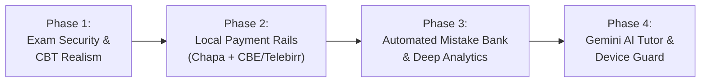

# Qelem («ቀለም») — Platform Architecture & Master System Overview (`overview.md`)

**Target Audience:** Ethiopian Grade 9–12 Candidates & University Entrance Aspirants (Natural & Social Science)  
**Curriculum Standard:** FDRE Ministry of Education Standardized National Syllabus & EAES CBT Specifications  
**Architecture Model:** Local-First PWA (Next.js 16 + React 19 + Serwist) with Supabase PostgreSQL & Server-Side Security  
**Document Version:** 3.0 (Master 4-Phase Production Architecture)  
**Last Updated:** October 18, 2026  

---

## 1. High-Level System Architecture

```mermaid
graph TD
    subgraph ClientLayer ["Client & PWA Layer (Next.js 16 + React 19)"]
        Landing["Landing & Pricing (/)"]
        PracticeRoom["CBT Test Room (/mock-exams/[id])"]
        StudyRoom["Curriculum Hub (/learn, /bank)"]
        MistakesRoom["Spaced Repetition Drill (/mistakes)"]
        SW["Serwist Service Worker (/sw.js)"]
        LocalCache["IndexedDB / LocalStore State"]
    end

    subgraph SecurityLayer ["Security & Routing Guard (proxy.ts)"]
        Proxy["Next.js Proxy / Middleware"]
        DeviceGuard["2-Device Session Limiter"]
        AdminGuard["Admin Key & Role Verifier"]
    end

    subgraph ServerAPILayer ["Serverless API & Security Boundaries"]
        ExamStart["/api/exams/start<br/>(Strips Keys & Derivations)"]
        ExamSubmit["/api/exams/[id]/submit<br/>(Server Grading & XP)"]
        ChapaPay["/api/payments/chapa/*<br/>(Telebirr, CBE Birr, Webhook)"]
        ManualPay["/api/payments/manual<br/>(Receipt Upload)"]
        AITutor["/api/ai/explain-custom<br/>(Gemini Flash Token-Gated)"]
        AdminIngest["/api/admin/*<br/>(PDF / Bulk Parser)"]
    end

    subgraph DatabaseLayer ["Supabase PostgreSQL + Storage"]
        Profiles["public.profiles"]
        Questions["public.questions"]
        ExamSessions["public.mock_exam_sessions"]
        MistakeBank["public.mistake_bank"]
        Payments["public.payments & coupons"]
        DeviceSessions["public.device_sessions"]
    end

    %% Connections
    PracticeRoom -->|Pre-caches & Offline Resilience| SW
    PracticeRoom <-->|Syncs Answers & Heartbeats| LocalCache
    PracticeRoom -->|1. Request Secure Paper| ExamStart
    PracticeRoom -->|2. Submit Answers for Grading| ExamSubmit
    
    Proxy --> DeviceGuard
    Proxy --> AdminGuard
    
    ExamStart --> Questions
    ExamSubmit --> ExamSessions
    ExamSubmit --> MistakeBank
    ChapaPay --> Payments
    ManualPay --> Payments
    AITutor --> Questions
    AdminIngest --> Questions
```



---

## 2. Four-Phase Master Implementation Architecture

The platform evolution is structured into 4 sequential, self-contained engineering phases to guarantee safety, zero downtime, and complete rollback safety:



### Phase 1: Exam Security, Server-Side Grading & Authentic CBT Experience
* **Core Objective:** Eliminate client-side answer key leakage during timed exams and upgrade the CBT test room to official EAES standards.
* **Key Components:**
  1. `/api/exams/start`: Sanitizes question payloads by removing `correctOptionId`, explanations, and derivation steps before transmitting to the client browser.
  2. `/api/exams/[id]/submit`: Secure server-side grading against database keys, time verification (preventing client clock tampering), and scoring calculation.
  3. `/api/exams/[id]/heartbeat`: Syncs partial candidate answers every 60 seconds with offline resilience.
  4. CBT UI Enhancements: Strikeout / Option Elimination toggle (crossing out eliminated options A, B, C, D) and tap-to-zoom diagram modal.

### Phase 2: Local Payment Rails & Monetization Engine
* **Core Objective:** Enable real-world revenue collection in Ethiopian Birr (ETB) through Chapa USSD rails and manual bank receipts.
* **Key Components:**
  1. Automated Chapa Gateway: `/api/payments/chapa/init` and `/api/payments/chapa/webhook` with cryptographic HMAC SHA-256 signature verification.
  2. Manual Receipt Fallback: `/api/payments/manual` allowing students to submit CBE/Telebirr transaction numbers or screenshots with `MANUAL_REVIEW` status.
  3. Admin Payment Verification: `/admin/payments` portal to review, approve, or reject manual slips with 1-click subscription activation.
  4. Entitlement Gating: Unlocking step-by-step derivations, offline paper downloads, and unlimited question bank drills.

### Phase 3: Automated Mistake Bank, Spaced Repetition & Deep Analytics
* **Core Objective:** Implement automated learning retention that targets candidate curriculum weaknesses.
* **Key Components:**
  1. Automated Mistake Bank: Incorrect answers from practice or mock exams are automatically upserted into `public.mistake_bank`.
  2. Spaced Repetition Engine: Implements the graduation rule where a question must be answered correctly **2 consecutive times on separate sessions** to be cleared.
  3. `/mistakes`: Dedicated practice drill room targeting failed concepts.
  4. Standalone Analytics (`/analytics`, `/analytics/report/[id]`): Pacing telemetry (average seconds per question, "Time Sink" questions >4 minutes), Grade 9–12 unit accuracy matrix, and projected aggregate score out of 600/700 compared to AAU cut-offs.

### Phase 4: Gemini AI Tutor, Anti-Piracy Device Guard & Social Growth
* **Core Objective:** Provide intelligent conceptual assistance, prevent account credential sharing, and drive viral student referral loops.
* **Key Components:**
  1. Gemini Flash AI Tutor: `/api/ai/explain-custom` with predefined prompts (*"Explain in simple Amharic"*, *"Show shortcut trick"*, *"Generate similar question"*), token-cached and rate-limited to 15 queries/day for Pro users.
  2. Anti-Piracy Device Guard: Cryptographic browser/device fingerprinting stored in `public.device_sessions`, limiting paid accounts to **maximum 2 registered devices** (1 mobile + 1 PC) and 1 active concurrent session.
  3. Social & Growth Engine: National, Regional, and School Leaderboards (`/leaderboard`) and referral invite system (`/referrals`).

---

## 3. Database Schema Architecture (Supabase PostgreSQL)

| Table | Status | Primary Purpose |
| :--- | :--- | :--- |
| `public.profiles` | Active | Candidate profile, stream, grade, target score, target university |
| `public.questions` | Active | Curriculum and past exam questions with KaTeX prompts, options, explanations |
| `public.practice_sessions` | Active | Baseline diagnostic sprint attempts |
| `public.mock_exam_sessions` | Active | Full-length 60-question CBT exam attempts and timing logs |
| `public.mistake_bank` | Active | Personalized mistake bank with fail count and consecutive correct tracking |
| `public.payments` | Active | CBE/Telebirr receipt reviews and monetization transaction logs |
| `public.coupons` | Phase 2 | Promo and campus ambassador discount codes |
| `public.device_sessions` | Phase 4 | Browser fingerprint hash and active session locks |

---

## 4. Emergency Rollback & Safety Procedures

To ensure complete safety and give you the ability to revert anytime if unexpected behavior occurs:

### 1. Git Version Control Checkpoints
Every phase and milestone is committed to local Git. You can inspect or revert changes using:
```bash
# Check current repository status
git status

# View commit history with checkpoint tags
git log --oneline -n 10

# View exact changes made in the latest commit
git show HEAD

# Roll back the most recent commit (preserving your working files)
git reset --soft HEAD~1

# Completely restore the repository to the baseline checkpoint
git reset --hard "chore: baseline checkpoint prior to 4-phase PRD implementation"
```

### 2. Zero-Disruption Build Verification
Every modification is verified against:
- Strict TypeScript compilation: `npm run type-check` (exits with code 0)
- Production Webpack build: `npm run build` (verifies all static and dynamic routes and service worker bundling)
