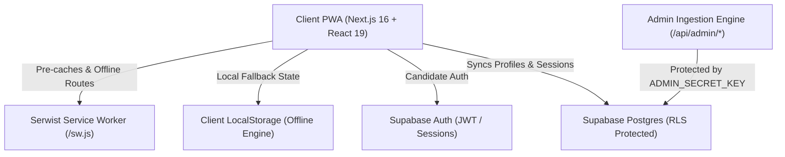

# Qelem (ቀለም) — Platform Architecture & System Overview (`overview.md`)

**Target Audience:** Ethiopian Grade 9–12 Candidates & University Entrance Aspirants  
**Curriculum Standard:** FDRE Ministry of Education Standardized National Syllabus (Natural & Social Science)  
**Architecture Model:** Local-First PWA with Supabase Cloud Synchronization  

---

## 1. System Architecture

---

## 2. Core Modules & Directory Layout

- **`src/app/`**: Next.js App Router
  - `(auth)/`: Canonical authentication screens (`/login`, `/signup`) with split-screen Apple-grade design tokens.
  - `(dashboard)/`: Candidate workspace
    - `/dashboard`: High-yield overview, diagnostic scores, matric countdown, subject coverage bars.
    - `/bank`: Filterable national question bank by subject, grade (9–12), exam year, and difficulty.
    - `/mock-exams`: Timed EUEE examination simulators with auto-submit and grade-level scorecards.
    - `/learn`: Theory, formula summaries, laws, and common misconception/trap breakdowns.
    - `/study-plan`: Personalized daily revision targets, milestones, and high-yield topic drills.
    - `/admin/questions`: Multi-format question parser (PDF, Markdown, CSV, JSON) and ingestion dashboard.
    - `/settings`: Candidate profile, stream switcher, target score, and target university config.
  - `api/admin/`: Protected admin ingestion and verification endpoints.
  - `api/seed/`: Curriculum database seeder.
  - `sw.ts`: Serwist service worker entry point.
- **`src/components/`**: Modular presentation layer
  - `landing/`: Studio-crafted landing page sections (Hero, Features, StreamSelector, HowItWorks, Pricing, FAQ, Footer).
  - `practice/`: Diagnostic test workspace (QuestionCard, PracticeHeader, ExplanationDrawer, DiagnosticSummary).
  - `ui/`: MathRenderer (KaTeX inline and block LaTeX formula renderer).
  - `auth/`: AuthModal with tabbed OAuth, email credentials, and guest fallback.
- **`src/lib/`**: Business logic, offline state & database clients
  - `userStore.ts`: Candidate profile store, countdown calendar, subject mastery definitions.
  - `questionStore.ts`: Question loading, filtering, parser, and storage synchronization.
  - `mockExamData.ts`: Official past paper catalogs and test attempt persistence.
  - `curriculumData.ts`: Master curriculum question set and unit definitions.
  - `cheatSheetData.ts`: Formula sheets, laws, and examiner tips.
  - `supabase/`: Browser and server SSR Supabase clients.

---

## 3. Security & Governance

1. **Environment Variables**:
   - `NEXT_PUBLIC_SUPABASE_URL`: Supabase project endpoint.
   - `NEXT_PUBLIC_SUPABASE_ANON_KEY`: Public client anon key.
   - `ADMIN_SECRET_KEY`: High-entropy secret for administrative API access.
   - `SUPABASE_SERVICE_ROLE_KEY`: Server-only secret for RLS bypass during database seeding.
2. **Access Control**:
   - Strict server-side verification on all `/api/admin/*` routes.
   - Middleware gating on `/admin/*` routes requiring verified admin authorization.
   - Row-Level Security (RLS) policies on `public.questions`, `public.profiles`, `public.practice_sessions`, and `public.mock_exam_sessions`.
3. **Repository Sanitation**:
   - Zero secrets committed to git.
   - Dedicated `.gitignore` strictly excluding `.env*`, `.next`, `node_modules`, and local build logs.
