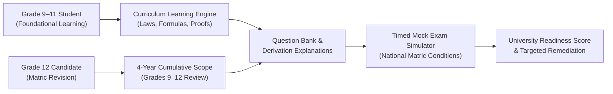
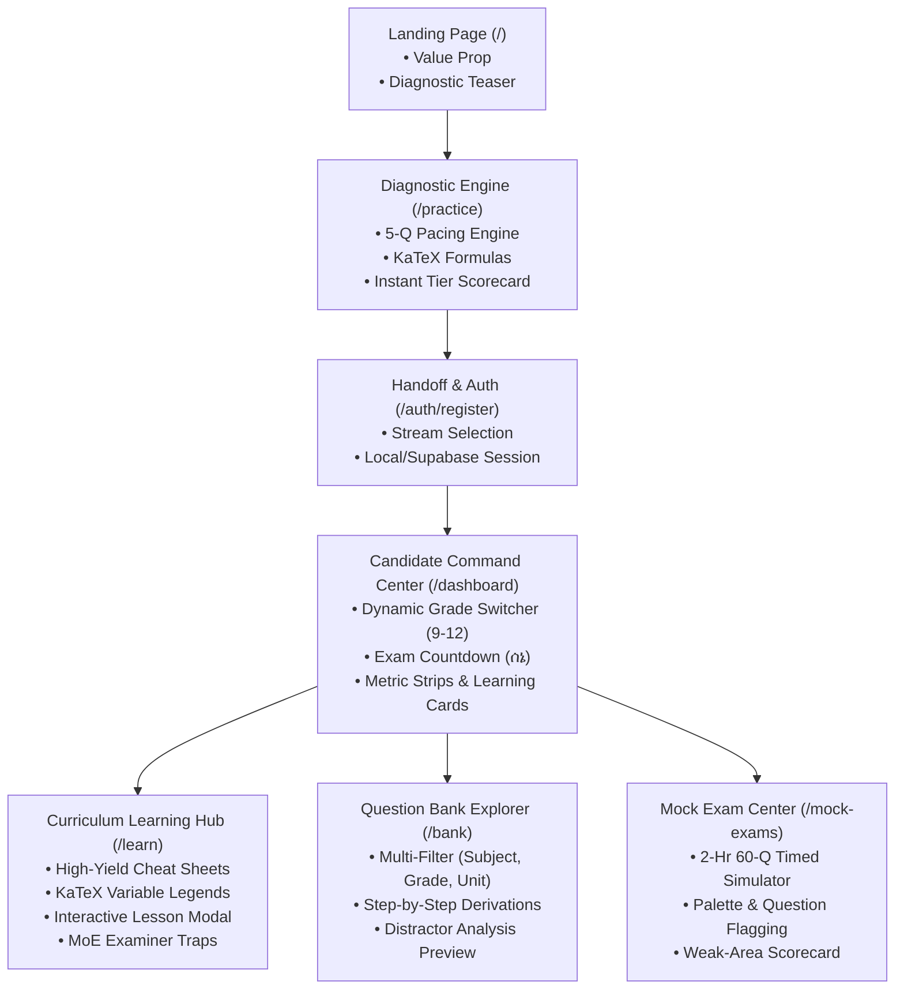
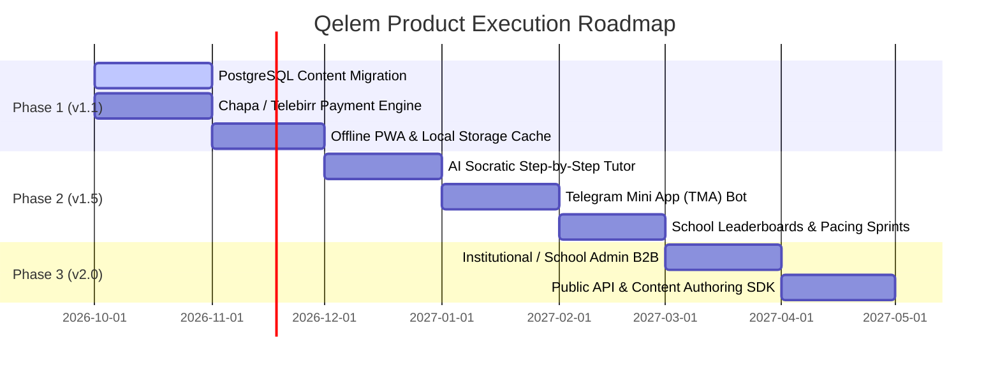

# QELEM («ቀለም») — Product Requirements Document (PRD) & Technical Architecture Scope
**Document Version:** 2.0.0  
**Target Release Cycle:** Ethiopian Academic Year 2017–2018 E.C. (2025–2026 G.C.)  
**Author:** Principal Product Manager & Technical Architect  
**Status:** Approved for Implementation & Engineering Sprint Planning  

---

## 1. Executive Summary & Strategy

### 1.1 Problem Statement
The Ethiopian secondary education system faces an unprecedented learning and placement crisis. Following the national reform of the Ethiopian University Entrance Examination (EUEE / Matric) administered via university computer centers:
1. **Severe Attrition Rates:** Over 95% of candidates nationally fail to achieve the university entrance benchmark score (50%+), driven by extreme disparities in regional classroom instruction, rote learning methodologies, and lack of test-taking stamina.
2. **Disconnected Revision Architecture:** Grade 12 students are tested cumulatively on **four full years of curriculum (Grades 9–12)** across 6 to 7 subjects. No unified digital platform exists that integrates foundational theory, rigorous mathematical derivations, and authentic exam-level question drills.
3. **Fragmented & Erroneous Study Materials:** Candidates currently depend on unorganized Telegram channels containing watermarked, unindexed PDFs riddled with calculation errors, missing diagrams, and zero pedagogical explanation of *why* distractors are incorrect.
4. **Bandwidth & Payment Realities:** High-speed internet is inconsistent outside urban centers, and international credit-card based EdTech platforms (e.g., Coursera, Quizlet) are entirely inaccessible due to foreign exchange limitations. Solutions must operate on local payment rails (Chapa, Telebirr, CBE Birr) and perform reliably over high-latency cellular networks.

### 1.2 Value Proposition & Job-to-be-Done (JTBD)
* **One-Liner:** Qelem is the premier Ethiopian STEM curriculum learning and national entrance exam acceleration platform, engineered to transform high school students from rote memorizers into high-scoring academic scholars.
* **Core JTBD:**
  > *"When preparing for my semester exams or national university entrance, I want a structured, distraction-free environment that teaches me governing laws, formulas, and derivations first—then tests me with authentic past-exam drills—so that I can secure a merit scholarship or competitive university placement (AAU Medicine, Technology, etc.) without paying exorbitant tutoring fees."*



### 1.3 Primary User Personas

| Dimension | Persona 1: Dawit Yohannes (The Matric Striver) | Persona 2: Selamawit Tadesse (Foundational Learner) | Persona 3: Ato Tesfaye (The Account Sponsor / Parent) |
| :--- | :--- | :--- | :--- |
| **Role & Grade** | Grade 12 Natural Science Candidate | Grade 9 / 10 Secondary Student | Parent of Grade 12 Candidate / High School STEM Teacher |
| **Location** | Addis Ababa / Hawassa (Regional Urban) | Bahir Dar / Adama | Addis Ababa / Diaspora Sponsor |
| **Primary Goal** | Score **585+/700** on EUEE to gain admission to AAU Institute of Technology (AAiT). | Master Grade 9 & 10 algebra, kinematics, and chemistry before semester finals. | Ensure their child is studying consistently and track verified performance data. |
| **Daily Workflow** | Uses phone/laptop between 6:00 PM – 10:30 PM; solves 25 questions daily, reviews formula cheat sheets. | Reviews chapter notes after class; works through derivations step-by-step. | Reviews weekly progress summary; finances platform access via Telebirr or CBE Birr. |
| **Core Frustrations** | Forgetting Grade 9 & 10 physics concepts; wasting hours on Telegram arguing over answer keys. | Textbooks present formulas without explaining what variables mean or how to derive them. | Paying 5,000+ ETB/month for private tutors with zero visibility into actual syllabus mastery. |

---

## 2. Current State Audit (v1.0 / As-Is)

### 2.1 Existing Capabilities Inventory



1. **Diagnostic Assessment Engine (`/practice`):**
   - 5-question adaptive sprint assessing candidate velocity, accuracy, and baseline readiness.
   - Live KaTeX formula rendering for complex mathematical notations.
   - Dynamic recommendation score calculation ($0-700$ matric scale) and diagnostic handoff modal.
2. **Candidate Command Center (`/dashboard`):**
   - Real-time grade switcher (`Gr. 9`, `Gr. 10`, `Gr. 11`, `Gr. 12 (Matric)`).
   - Dynamic context banners: switches between *Foundational Curriculum* and *Full 4-Year Cumulative Scope*.
   - Compact metric telemetry: Exam Countdown (142d to ሰኔ E.C.), Target Score (585/700), Solved Questions, and Syllabus Unit progress.
   - Bidirectional learning bridge: Each card links to both **Learn** and **Practice Qs**.
3. **Curriculum Learning & Revision Engine (`/learn`):**
   - Modular lessons across Natural Science (Physics, Mathematics, Chemistry, Biology) for Grades 9, 10, 11, and 12.
   - Interactive Lesson Reader Modal featuring:
     - Chapter Syllabus Summary.
     - KaTeX Essential Formulas with complete SI Unit variable tables.
     - Governing Laws & Principles with physical conditions.
     - National Exam Examiner Traps & Common Misconceptions.
     - Direct CTA linking into chapter-filtered question sets.
4. **Curriculum Question Bank (`/bank`):**
   - Multi-criteria filter matrix: Subject, Grade Level, Unit Number, Difficulty, and National Exam Year (e.g., 2016 E.C., 2015 E.C.).
   - Tiered solution architecture: Basic derivations accessible to Free users; Core Governing Laws and Distractor Traps previewed with Pro gating.
5. **National Exam Timed Simulator (`/mock-exams` & `/mock-exams/[examId]`):**
   - Authentic 2-hour, 60-question examination test room simulating Ethiopian Ministry of Education computer-based testing conditions.
   - Navigation palette, question flagging, countdown timer, auto-submit on expiration, and comprehensive diagnostic performance review.
6. **Administrative Portal (`/admin/questions`):**
   - Internal question authoring interface with live KaTeX dual-pane preview, difficulty tags, and step-by-step derivation input.

### 2.2 Baseline Technical Architecture
* **Frontend:** Next.js 15 (App Router, Server & Client Components), React 19, TypeScript, Tailwind CSS.
* **Math Pipeline:** Custom KaTeX tokenizer (`MathRenderer.tsx`) supporting both display equations (`$$...$$`) and baseline-aligned inline formulas (`$...$`).
* **Database & Auth:** Supabase PostgreSQL with Row-Level Security (RLS). Tables initialized: `profiles`, `practice_sessions`. LocalStorage fallback store (`userStore.ts`) ensures seamless demo experience without hard auth blocks.

### 2.3 Known Technical Debt & UX Friction Points
1. **Static Bundle Data Seed:** Questions and learning cheat sheets currently reside in bundled TypeScript objects (`curriculumData.ts`, `cheatSheetData.ts`). This limits bank scalability beyond 1,000 questions and prevents real-time dynamic content curation.
2. **Simulated Payment Gate:** The Chapa checkout modal triggers a UI simulation rather than an end-to-end cryptographic checkout session with webhook verification.
3. **Lack of Offline Resiliency:** If a candidate experiences a cellular drop during a 60-question mock exam, questions not pre-cached fail to render, risking student frustration.
4. **Uninstrumented Session Analytics:** Question dwell time and option-change frequency are computed client-side but not fully persisted to PostgreSQL for deep machine-learning diagnostics.

---

## 3. Future State & Phased Roadmap (v1.1 to v2.0)



### 3.1 Phase 1: Hardening & Commercialization (v1.1) — Q4 2026
* **Database Content Ingestion:** Migrate all 65 curriculum units and 5,000+ past exam questions to Supabase PostgreSQL with full-text search indexes (`tsvector`).
* **Production Payment Integration:** Full integration with **Chapa API** (Telebirr, CBE Birr, Awash Birr, Cards). Server-side webhook verification, cryptographic transaction receipts, and automatic entitlement provisioning.
* **Offline-First Question Engine:** PWA service workers caching active practice sessions and formula sheets for 100% offline study continuity.
* **Granular Telemetry Ingestion:** Capture per-question dwell times, distractor selection patterns, and revision frequencies.

### 3.2 Phase 2: Core Value Expansion (v1.5) — Q1 2027
* **Qelem AI Tutor («ቀለም ረዳት»):** Context-aware Socratic AI assistant that breaks down difficult KaTeX steps, provides hints without giving away answers, and explains concepts in English or Amharic.
* **Telegram Mini App (TMA) Integration:** Native Telegram web app client allowing Ethiopian students with low data bundles to practice daily 5-minute sprints directly inside Telegram.
* **Timed National Sprint Contests:** Weekly scheduled, synchronized mock challenges with school-level and national leaderboards to stimulate viral peer engagement.

### 3.3 Phase 3: Scale & Institutional B2B (v2.0) — Q2 2027
* **School & Educator Command Center:** Dedicated portal for private/public schools to purchase bulk student seats, assign customized homework units, and track real-time school matric readiness.
* **Offline Desktop Kiosk Application:** Electron/Tauri build for school computer labs lacking stable internet, syncing via periodic local server pings.

### 3.4 Explicit Non-Goals (Scope Containment)
To maintain velocity and high product quality, the following features are explicitly **out of scope** for v1.x:
- ❌ **Live Video Streaming / 1-on-1 Tutoring:** Qelem is an asynchronous, self-paced mastery engine. Live video introduces bandwidth overhead and high operational costs.
- ❌ **K–8 Primary School Subjects:** Strict focus remains on Secondary School (Grades 9–12) and University Entrance.
- ❌ **Unmoderated Peer-to-Peer Chat:** No open-ended user chats within the platform to eliminate moderation liabilities; community discussions are channeled into the official moderated Telegram community (`@qelem_edu`).

---

## 4. Detailed Feature Specifications & Acceptance Criteria

### 4.1 Feature 1: Automated Chapa / Telebirr Payment & Pro Gating

#### User Story
> **As a** Grade 12 candidate or parent,  
> **I want to** pay for a Pro subscription (350 ETB/term or 950 ETB/annual) instantly using Telebirr or CBE Birr via Chapa,  
> **So that** I immediately unlock complete distractor explanations, full-length mock exams, and advanced derivation steps without manual admin approval.

#### Functional Requirements
1. **Trigger Points:**
   - Clicking "Unlock Pro Solutions" in the `/bank` solution drawer.
   - Attempting to launch a premium mock exam in `/mock-exams`.
   - Clicking "Upgrade to Pro" in the top navigation or user settings.
2. **Transaction Workflow:**
   - Client requests checkout initialization via `POST /api/payments/chapa/initialize`.
   - Backend validates user session, creates a pending record in `subscriptions`, and calls Chapa API `v1/transaction/initialize` with callback and return URLs.
   - User is redirected to the Chapa hosted checkout (Telebirr QR / CBE Birr USSD / Debit Card).
   - Upon payment completion, Chapa sends an asynchronous HTTP POST webhook to `/api/webhooks/chapa` with signature verification (`x-chapa-signature`).
   - Webhook handler verifies SHA-256 HMAC signature, updates `subscriptions` status to `active`, and updates the user profile's `tier` to `pro`.
   - Real-time client listener or return page polls/receives webhook confirmation and reveals premium content without page reload.

#### Acceptance Criteria (Gherkin Syntax)

```gherkin
Scenario: Successful Pro upgrade via Telebirr
  Given an authenticated candidate with tier "free"
  When the user selects the "Matric Pro — 350 ETB" plan and clicks "Pay with Telebirr"
  Then the system generates a secure Chapa transaction reference "QEL-SUB-{uuid}"
  And redirects the user to Chapa checkout
  When Chapa fires a valid webhook event "charge.success" with matching signature
  Then the database updates the user's tier to "pro" with expiry date set to +120 days
  And the user receives access to all distractor analysis and mock exams.

Scenario: Webhook arrives with invalid HMAC signature
  Given an incoming HTTP POST request to "/api/webhooks/chapa"
  When the "x-chapa-signature" header does not match the computed HMAC-SHA256 of the payload using CHAPA_SECRET_KEY
  Then the endpoint immediately rejects the request with HTTP 401 Unauthorized
  And no user subscription or profile status is modified
  And a security alert is recorded in audit logs.

Scenario: User drops connection during payment redirect
  Given a user who initiated checkout but closed the browser before returning to Qelem
  When Chapa successfully completes the transaction and delivers the webhook
  Then the user's account is automatically upgraded asynchronously
  And upon the user's next login, the UI instantly reflects "Pro Candidate" status.
```

---

### 4.2 Feature 2: Database-Backed Question Bank with Full-Text KaTeX Search

#### User Story
> **As a** student studying for a specific physics test,  
> **I want to** filter and search questions by Grade (9–12), Subject, Unit, and keyword (e.g. "Doppler effect", "Coulomb"),  
> **So that** I can practice targeted problem sets with step-by-step mathematical proofs.

#### Functional Requirements
1. **Filter Hierarchy:**
   - Top-level: Grade (`9`, `10`, `11`, `12`, or `All`).
   - Stream: `Natural Science` (Physics, Math-Nat, Chemistry, Biology) vs. `Social Science` (Math-Soc, History, Geography, Economics).
   - Unit: Dynamic unit picker populated from the curriculum schema.
   - Difficulty: `Foundation`, `Moderate`, `Advanced`.
   - Source: National Exam year (`2016 E.C.`, `2015 E.C.`, `2014 E.C.`, etc.).
2. **Search Capabilities:**
   - Full-text search over question prompts, LaTeX formulas, and unit titles using PostgreSQL `websearch_to_tsquery`.
   - Instant debounced search (300ms) with zero layout shift.
3. **Question Card Presentation:**
   - KaTeX rendering with baseline alignment.
   - Interactive choice selector: gives immediate feedback in practice mode, or registers state for bulk submission.
   - Solution Drawer: displays step-by-step derivations, key formulas with variable breakdown, and examiner distractor traps.

#### Acceptance Criteria (Gherkin Syntax)

```gherkin
Scenario: Filtering questions by Grade and Topic
  Given the question bank containing 5,000 indexed questions
  When the user selects Grade "10" and Subject "Physics" and Unit "Unit 2: Electrostatics"
  Then the bank view updates within 200ms to display only Grade 10 Electrostatics questions
  And the active count indicator reflects the exact number of matching questions.

Scenario: Free user viewing a Pro-gated solution
  Given an authenticated user on the "free" tier
  When the user solves a question and clicks "View In-Depth Solution"
  Then the system renders the basic derivation steps
  But the "Distractor Trap Analysis" and "Examiner Insight" sections are rendered with a glass-blur filter
  And a high-emphasis CTA button "Unlock Pro Solutions — 350 ETB" is displayed.
```

---

### 4.3 Feature 3: Full-Scale National Matric Timed Exam Simulator

#### User Story
> **As a** Grade 12 candidate,  
> **I want to** take a full 60-question, 120-minute timed mock entrance exam with a real-time question palette and auto-save,  
> **So that** I can build authentic test pacing, manage exam anxiety, and receive an estimated matric percentile ranking.

#### Functional Requirements
1. **Exam Room Lockdown:**
   - Clean, distraction-free interface hiding main sidebar and extraneous navigation.
   - Persistent countdown timer synced to server timestamp (prevents client clock manipulation).
2. **State Persistence & Offline Safeguard:**
   - Every answer selection is written immediately to IndexedDB and debounced-synced to Supabase via `POST /api/exam/record-answer`.
   - In case of network disconnection, the UI displays an unobtrusive "Offline Mode — Answers Saved Locally" badge.
3. **Question Navigation Palette:**
   - 60-bubble matrix indicating: *Unvisited* (gray), *Answered* (solid dark), *Flagged for Review* (amber flag), *Current Question* (blue outline).
4. **Automated Submission & Scorecard Generation:**
   - At $T=0$, the system locks all choices and automatically submits the attempt.
   - Instant generation of Diagnostic Scorecard:
     - Scaled score (e.g., $54 / 60 \rightarrow 90\%$).
     - Topic-by-topic breakdown (e.g., Electromagnetism: 80%, Quantum Mechanics: 40%).
     - Remediation links: direct buttons to "Review Concept Notes in Learn Hub" for weak units.

#### Acceptance Criteria (Gherkin Syntax)

```gherkin
Scenario: Exam timer expiration triggers automated submission
  Given an active mock exam session with 10 seconds remaining
  When the countdown timer reaches 00:00:00
  Then the exam interface disables all radio inputs immediately
  And automatically submits all answered and unanswered questions to "/api/mock-exams/submit"
  And redirects the candidate to the scorecard summary page within 2 seconds.

Scenario: Candidate flags question for review
  Given a candidate viewing question #24 in the mock exam room
  When the candidate clicks the "Flag for Review" button
  Then the question bubble #24 in the palette displays an amber indicator
  And the candidate can jump to any other question and return to #24 with a single click.
```

---

## 5. Technical Requirements & Architecture

### 5.1 System Architecture Diagram

```mermaid
graph TB
    subgraph Client Layer
        Web["Next.js 15 PWA Client<br/>(Desktop & Mobile)"]
        TMA["Telegram Mini App (TMA)<br/>(Webview)"]
    end

    subgraph Edge & API Gateway
        Vercel["Vercel Edge Network / SSR"]
        AuthMiddleware["Supabase Auth Middleware<br/>(JWT Verification)"]
    end

    subgraph Application Services
        NextAPI["Next.js Route Handlers<br/>• /api/payments/*<br/>• /api/curriculum/*<br/>• /api/mock-exams/*"]
        KaTeX["Client KaTeX Math Engine"]
    end

    subgraph Backend & Storage (Supabase)
        Postgres[(PostgreSQL 15)]
        RLS["Row Level Security Engine"]
        FTS["Full Text Search (tsvector)"]
        Storage["Supabase Storage<br/>(Question Diagrams)"]
    end

    subgraph External Services
        Chapa["Chapa Payment Gateway<br/>(Telebirr / CBE / Cards)"]
        TeleHook["Telegram Bot API"]
    end

    Web --> Vercel
    TMA --> Vercel
    Vercel --> AuthMiddleware
    AuthMiddleware --> NextAPI
    NextAPI --> Chapa
    NextAPI --> RLS
    RLS --> Postgres
    Postgres --> FTS
    Chapa -. Webhook .-> NextAPI
```

---

### 5.2 Extended PostgreSQL Data Schema (Migration 002)

```sql
-- ==============================================================================
-- Migration: 002_curriculum_and_monetization.sql
-- Description: Adds questions, curriculum units, attempts, and subscriptions.
-- ==============================================================================

-- 1. ENUMS
CREATE TYPE subscription_tier AS ENUM ('free', 'pro', 'institutional');
CREATE TYPE subscription_status AS ENUM ('pending', 'active', 'expired', 'cancelled');
CREATE TYPE question_difficulty AS ENUM ('foundation', 'moderate', 'advanced');

-- 2. ENHANCE PROFILES TABLE
ALTER TABLE public.profiles 
  ADD COLUMN IF NOT EXISTS tier subscription_tier NOT NULL DEFAULT 'free',
  ADD COLUMN IF NOT EXISTS phone_number TEXT,
  ADD COLUMN IF NOT EXISTS school_name TEXT,
  ADD COLUMN IF NOT EXISTS total_xp INTEGER NOT NULL DEFAULT 0;

-- 3. SUBSCRIPTIONS TABLE
CREATE TABLE IF NOT EXISTS public.subscriptions (
  id UUID PRIMARY KEY DEFAULT gen_random_uuid(),
  user_id UUID NOT NULL REFERENCES public.profiles(id) ON DELETE CASCADE,
  tier subscription_tier NOT NULL DEFAULT 'pro',
  status subscription_status NOT NULL DEFAULT 'pending',
  amount_etb NUMERIC(10, 2) NOT NULL,
  payment_provider TEXT NOT NULL DEFAULT 'chapa',
  provider_tx_ref TEXT UNIQUE NOT NULL,
  provider_payment_method TEXT, -- 'telebirr', 'cbebirr', 'card'
  starts_at TIMESTAMPTZ,
  expires_at TIMESTAMPTZ,
  created_at TIMESTAMPTZ NOT NULL DEFAULT timezone('utc'::text, now()),
  updated_at TIMESTAMPTZ NOT NULL DEFAULT timezone('utc'::text, now())
);

CREATE INDEX idx_subscriptions_user_status ON public.subscriptions(user_id, status);

-- 4. CURRICULUM QUESTIONS TABLE
CREATE TABLE IF NOT EXISTS public.questions (
  id TEXT PRIMARY KEY, -- e.g., 'phy-12-01'
  subject_id TEXT NOT NULL, -- 'physics', 'math-nat', etc.
  grade INTEGER NOT NULL CHECK (grade IN (9, 10, 11, 12)),
  unit_number INTEGER NOT NULL,
  unit_title TEXT NOT NULL,
  prompt TEXT NOT NULL,
  options JSONB NOT NULL, -- Array of { id: "A", text: "..." }
  correct_option_id VARCHAR(2) NOT NULL,
  explanation TEXT NOT NULL,
  derivation_steps JSONB NOT NULL DEFAULT '[]'::jsonb, -- Array of string steps
  key_formula TEXT,
  exam_year TEXT, -- '2016 E.C.'
  difficulty question_difficulty NOT NULL DEFAULT 'moderate',
  distractor_analysis JSONB DEFAULT '[]'::jsonb, -- Array of DistractorTrap
  examiner_insight TEXT,
  is_pro_gated BOOLEAN NOT NULL DEFAULT false,
  diagram_url TEXT,
  search_vector tsvector GENERATED ALWAYS AS (
    to_tsvector('english', prompt || ' ' || unit_title || ' ' || COALESCE(key_formula, ''))
  ) STORED,
  created_at TIMESTAMPTZ NOT NULL DEFAULT timezone('utc'::text, now())
);

CREATE INDEX idx_questions_lookup ON public.questions(subject_id, grade, unit_number);
CREATE INDEX idx_questions_search ON public.questions USING GIN(search_vector);

-- 5. USER QUESTION ATTEMPTS (Telemetry & Spaced Repetition)
CREATE TABLE IF NOT EXISTS public.user_question_attempts (
  id UUID PRIMARY KEY DEFAULT gen_random_uuid(),
  user_id UUID NOT NULL REFERENCES public.profiles(id) ON DELETE CASCADE,
  question_id TEXT NOT NULL REFERENCES public.questions(id) ON DELETE CASCADE,
  selected_option VARCHAR(2),
  is_correct BOOLEAN NOT NULL,
  time_spent_seconds INTEGER NOT NULL DEFAULT 0,
  context TEXT NOT NULL DEFAULT 'bank', -- 'bank', 'diagnostic', 'mock'
  attempted_at TIMESTAMPTZ NOT NULL DEFAULT timezone('utc'::text, now())
);

CREATE INDEX idx_user_attempts_user_q ON public.user_question_attempts(user_id, question_id);
CREATE INDEX idx_user_attempts_analytics ON public.user_question_attempts(user_id, is_correct, attempted_at DESC);

-- 6. MOCK EXAM SESSIONS TABLE
CREATE TABLE IF NOT EXISTS public.mock_exam_sessions (
  id UUID PRIMARY KEY DEFAULT gen_random_uuid(),
  user_id UUID NOT NULL REFERENCES public.profiles(id) ON DELETE CASCADE,
  title TEXT NOT NULL,
  stream TEXT NOT NULL CHECK (stream IN ('natural', 'social')),
  total_questions INTEGER NOT NULL DEFAULT 60,
  answered_count INTEGER NOT NULL DEFAULT 0,
  correct_count INTEGER NOT NULL DEFAULT 0,
  score_percentage NUMERIC(5, 2) NOT NULL DEFAULT 0.00,
  time_allowed_seconds INTEGER NOT NULL DEFAULT 7200,
  time_taken_seconds INTEGER NOT NULL DEFAULT 0,
  answers JSONB NOT NULL DEFAULT '{}'::jsonb, -- { questionId: selectedOption }
  question_ids TEXT[] NOT NULL,
  is_completed BOOLEAN NOT NULL DEFAULT false,
  started_at TIMESTAMPTZ NOT NULL DEFAULT timezone('utc'::text, now()),
  completed_at TIMESTAMPTZ
);

CREATE INDEX idx_mock_sessions_user ON public.mock_exam_sessions(user_id, is_completed);

-- 7. ROW-LEVEL SECURITY ENFORCEMENT
ALTER TABLE public.subscriptions ENABLE ROW LEVEL SECURITY;
ALTER TABLE public.questions ENABLE ROW LEVEL SECURITY;
ALTER TABLE public.user_question_attempts ENABLE ROW LEVEL SECURITY;
ALTER TABLE public.mock_exam_sessions ENABLE ROW LEVEL SECURITY;

-- Questions are readable by all authenticated and guest users
CREATE POLICY "Public questions read access" ON public.questions FOR SELECT USING (true);

-- User attempts are strictly private to each candidate
CREATE POLICY "Users can only view their own attempts" ON public.user_question_attempts
  FOR SELECT USING (auth.uid() = user_id);

CREATE POLICY "Users can insert their own attempts" ON public.user_question_attempts
  FOR INSERT WITH CHECK (auth.uid() = user_id);

-- Subscriptions are viewable by owner only
CREATE POLICY "Users can view their own subscriptions" ON public.subscriptions
  FOR SELECT USING (auth.uid() = user_id);
```

---

### 5.3 API Specifications

#### Endpoint 1: Initialize Payment Transaction
* **Route:** `POST /api/payments/chapa/initialize`
* **Auth Level:** `Bearer JWT (Authenticated User)`
* **Request Headers:** `Content-Type: application/json`, `Authorization: Bearer <token>`
* **Request Body:**
  ```json
  {
    "planId": "pro_matric_term",
    "amount": 350,
    "currency": "ETB",
    "phoneNumber": "0911223344",
    "paymentMethod": "telebirr"
  }
  ```
* **Success Response (HTTP 200 OK):**
  ```json
  {
    "status": "success",
    "checkoutUrl": "https://checkout.chapa.co/checkout/payment/1234567890",
    "txRef": "QEL-SUB-a1b2c3d4-e5f6-7890"
  }
  ```
* **Error Response (HTTP 400 Bad Request):**
  ```json
  {
    "status": "error",
    "message": "Invalid phone number or plan configuration"
  }
  ```

#### Endpoint 2: Chapa Webhook Handler
* **Route:** `POST /api/webhooks/chapa`
* **Auth Level:** `HMAC Verification (x-chapa-signature)`
* **Request Headers:** `x-chapa-signature: <hex_digest>`
* **Request Body:**
  ```json
  {
    "event": "charge.success",
    "tx_ref": "QEL-SUB-a1b2c3d4-e5f6-7890",
    "amount": 350.00,
    "currency": "ETB",
    "payment_method": "telebirr",
    "status": "success"
  }
  ```
* **Success Response (HTTP 200 OK):**
  ```json
  {
    "received": true,
    "status": "processed"
  }
  ```

#### Endpoint 3: Filter & Query Questions (Paginated)
* **Route:** `GET /api/curriculum/questions`
* **Auth Level:** `Public / Optional Authenticated`
* **Query Parameters:**
  - `grade`: `9 | 10 | 11 | 12 | all`
  - `subjectId`: `physics | math-nat | chemistry | biology`
  - `unit`: `number (optional)`
  - `q`: `search_string (optional)`
  - `page`: `number (default: 1)`
  - `limit`: `number (default: 20)`
* **Success Response (HTTP 200 OK):**
  ```json
  {
    "data": [
      {
        "id": "phy-12-01",
        "subject": "Physics",
        "grade": 12,
        "unitNumber": 2,
        "unitTitle": "Electromagnetism & Induction",
        "prompt": "A magnetic flux through a coil changes...",
        "options": [
          { "id": "A", "text": "2.4 V" },
          { "id": "B", "text": "4.8 V" }
        ],
        "keyFormula": "\\mathcal{E} = -N\\frac{d\\Phi_B}{dt}",
        "isProGated": false
      }
    ],
    "pagination": {
      "total": 142,
      "page": 1,
      "totalPages": 8
    }
  }
  ```

---

## 6. Business Logic, Pricing & Feature Gating

### 6.1 Tier Entitlement Matrix

| Platform Feature | Free Tier | Pro Candidate (350 ETB / Term) | Institutional / School Partner |
| :--- | :---: | :---: | :---: |
| **Grade 9–12 Theory & Cheat Sheets** | ✅ Full Access | ✅ Full Access | ✅ Full Access |
| **KaTeX Formulas & Variable Legends** | ✅ Full Access | ✅ Full Access | ✅ Full Access |
| **Practice Questions / Day** | 5 Questions / Day | ♾️ Unlimited | ♾️ Unlimited |
| **Basic Step-by-Step Derivation** | ✅ Included | ✅ Included | ✅ Included |
| **Examiner Distractor Traps & Insights** | ❌ Locked Preview | ✅ Full Unlocked | ✅ Full Unlocked |
| **Full 2-Hour Matric Exam Simulator** | 1 Diagnostic Trial | ♾️ Unlimited Mock Sessions | ♾️ Unlimited |
| **Weak-Area Remediation AI Generator** | ❌ Not Included | ✅ Included | ✅ Included |
| **School Cohort Dashboard & Analytics**| ❌ Not Included | ❌ Not Included | ✅ Admin Portal Included |
| **Offline PWA Local Cache** | Last 10 Questions | Full Unit Offline Pack | Full School Sync |

### 6.2 Quota Metering & Soft Enforcement Logic
1. **Daily Practice Cap for Free Users:**
   - Client checks `attempts_today` stored in Supabase (or cached local token).
   - Upon submitting question #5, a celebratory modal appears: *"You've hit your free daily mastery target! Review today's formulas or upgrade to Pro for unlimited 4-year question drills."*
2. **Graceful Degraded Viewing (Glass-Blur):**
   - When a free user inspects a premium solution, the `distractorAnalysis` HTML is masked via CSS `backdrop-blur-sm select-none pointer-events-none`.
   - **Crucial Security Measure:** The sensitive `distractorAnalysis` JSON is **never serialized in the HTTP response payload** for free users. The backend API controller strips these fields prior to response dispatch, preventing client-side DevTools tampering.

---

## 7. Metrics, Telemetry & Instrumentations

### 7.1 North Star Metric
* **Weekly Active Mastery Solvers (WAMS):** Number of unique candidates who solve $\ge 20$ curriculum questions per week with $\ge 70\%$ derivation engagement.

### 7.2 Key Performance Indicators (KPIs)
1. **Diagnostic-to-Registration Rate:** $\ge 42\%$ of landing page visitors who complete the 5-question diagnostic register for an account.
2. **Registration-to-Paid Conversion Rate:** $\ge 6.5\%$ of active registered candidates convert to a paid Pro tier within 14 days.
3. **Day-30 Retention (D30):** $\ge 38\%$ of Grade 12 candidates return weekly up until the national exam month (ሰኔ).
4. **Matric Outcome Correlation:** Candidates with $\ge 80\%$ platform syllabus readiness achieve a national exam pass rate of $\ge 85\%$ (vs. the 5% national average).

### 7.3 Telemetry Event Dictionary

```typescript
// Core telemetry payload contracts
export type TelemetryEvent =
  | { event: "diagnostic_started"; stream: "natural" | "social" }
  | { event: "diagnostic_completed"; score: number; predictedTier: string; timeSpent: number }
  | { event: "grade_switched"; previousGrade: number; newGrade: number }
  | { event: "lesson_reader_opened"; sheetId: string; grade: number; unitNumber: number }
  | { event: "lesson_tab_viewed"; tab: "overview" | "formulas" | "laws" | "traps" }
  | { event: "question_answered"; questionId: string; isCorrect: boolean; timeSpentSeconds: number }
  | { event: "pro_gate_triggered"; source: "distractor_preview" | "mock_exam_locked" | "quota_limit" }
  | { event: "checkout_initiated"; planId: string; amountETB: number; provider: "chapa" }
  | { event: "checkout_completed"; planId: string; txRef: string };
```

---

## 8. Release Verification & Acceptance Sign-off

| Milestone | Target Date | Criteria for Verification | Sign-off Owner |
| :--- | :--- | :--- | :--- |
| **M1: PRD Approval** | 2026-09-27 | Architecture, pricing model, and Gherkin criteria fully ratified. | Principal PM & Architect |
| **M2: Schema Migration** | 2026-10-05 | Migration `002_curriculum_and_monetization.sql` executed with RLS active. | Database Lead |
| **M3: Chapa Webhook Sandbox** | 2026-10-15 | Automated test suite passes 100% of Chapa mock webhook events. | Backend Tech Lead |
| **M4: PWA Offline Beta** | 2026-10-25 | Offline test room verified on 3G cellular emulation with zero state loss. | QA Lead |
| **M5: Commercial Launch** | 2026-11-01 | Production live release for Ethiopian 2017 E.C. Matric candidates. | Executive Leadership |
